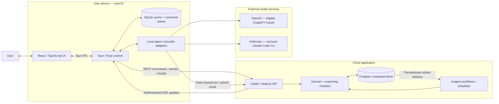

# AI Work OS — Architecture

Status: V0 target architecture · Updated: 2026-10-06

This document defines the intended system boundaries, responsibilities, data ownership, and execution flows. The workspace currently contains design artifacts, not an implemented application. Paths below are proposed. Technology choices marked provisional require validation before implementation.

Intended location in the application repository: `architecture.md` at the repository root. Implementation plans, API specifications, and individual architectural decision records should remain separate.

## 1. Product and scope

The application turns goals into executable plans and adjusts those plans as evidence changes. The User remains in control of consequential changes.

**Goal → plan → actions → evidence/events → reasoning → replan → next action → User.**

V0 supports three complete workflows:

1. The User creates a mission from a goal and context, reviews a proposed plan, and activates it.
2. The User supplies evidence or updates work; the system evaluates progress and proposes relevant plan changes.
3. The User sees prioritized next actions, blockers, approval requests, and basic reminders in the desktop application.

V0 supports workspaces with one or more Users and Users belonging to multiple workspaces. Goals and personal knowledge belong to the User; workspaces organize shared execution and collaboration.

V0 includes manual evidence, shared cloud state, local caching, local model-provider execution, an approval loop, and an audit trail. The local agent handles synchronization and provider jobs; it does not continuously inspect arbitrary applications or files.

**Outside V0:** the macOS notch companion/AppKit layer; GitHub, Gmail, and Calendar integrations; autonomous external actions; multi-agent execution; semantic/vector retrieval; and cloud execution using paid model API keys. These are extension points, not required dependencies.

## 2. Architecture decisions

| Area | V0 selection | Reason and tradeoff |
|---|---|---|
| Desktop shell | Tauri 2 / Rust | Native integration and controlled access to local resources. Introduces a Rust/TypeScript boundary. |
| User interface | React / TypeScript | Mission, action, evidence, approval, and attention views. UI remains independent of model providers. |
| Local storage | SQLite | Cache and durable outgoing command queue; never the authority for shared state. |
| Cloud application | Node.js / TypeScript / Fastify | One modular backend for HTTP, authorization, domain operations, and workflow handlers. |
| Shared database | PostgreSQL | Transactions across current state, domain events, audit records, and outbox entries. Neon is the proposed managed host. |
| Background execution | Inngest | Durable orchestration, retries, scheduled work, and resumable reasoning workflows. |
| Transport | HTTPS REST + authenticated SSE | REST for commands and queries; SSE for incremental notifications and synchronization hints. |
| Model access | Local provider adapters | ChatGPT subscription OAuth where eligible; installed, authenticated Claude Code CLI. Eligibility is a release gate. |
| Bounded decisions | Deterministic rules; optional Jev adapter | Jev can assist relevance or evidence scoring, but is not a permission authority or required V0 dependency. |

Start with a **modular monolith**. The context engine, planner, replanner, evaluator, and next-action engine are modules, not separately deployed services. A reasoning run may combine stages into one model request; stage names do not imply separate agents or calls.

Use ordinary relational current-state tables plus append-only event history and a transactional outbox. V0 does not require reconstructing all application state by replaying events.

## 3. Runtime boundaries



The cloud owns durable product state and decides whether a proposed change can commit. The desktop owns local credentials and invokes the selected provider. Model inference is still remote even when the provider adapter runs locally.

SSE does not carry credentials or serve as a durable job queue. Desktop model workers discover pending work through authenticated REST queries, with SSE providing wake-up hints.

## 4. Module ownership and dependency rules

| Module | Responsibility | Owns or returns |
|---|---|---|
| Identity / workspace | Authenticate application sessions; enforce membership and access | User, workspace, membership, registered device |
| Personal knowledge / goals | Maintain user-owned goals, preferences, knowledge, provenance, and explicit sharing | Personal goals, knowledge items, goal–mission links, sharing grants |
| Missions / work | Validate and commit mission, checkpoint, dependency, and action transitions | Current mission and action state; plan versions |
| Evidence / events | Accept provenance-tagged evidence and record domain events | Evidence records; append-only domain history |
| Context engine | Assemble user-centered context across authorized sources, filtered for the intended audience | Versioned context manifest with source scopes and audience |
| Mission interpreter / planner | Translate goals and constraints into a proposed plan | Structured plan proposal |
| Progress evaluator / replanner | Compare evidence with completion criteria; propose justified changes | Progress assessment and plan diff |
| Next-action engine | Rank actionable work, expose blockers and decisions, manage reminders | Attention items and reminder state |
| Policy / approvals | Apply deterministic rules; bind User decisions to an exact proposal | Approval decision and authorization result |
| Reasoning coordinator | Manage provider requests, leases, result validation, and stale-result handling | Reasoning request and validated result |
| Infrastructure adapters | Database, Inngest, provider bridges, optional Jev, future integrations | Implementations of application ports |

Domain modules expose application services. HTTP routes and workflow handlers call those services; neither duplicates business rules. Only the owning module changes its records. Cross-module changes use an explicit application operation and a shared transaction where atomicity is required.

Dependency direction: **HTTP/workflows → application services → domain rules**. Infrastructure adapters implement ports defined by the application. A composition layer wires adapters to services. Domain rules do not import Fastify, Inngest, React, or provider SDKs.

Shared contracts contain versioned request, event, and result schemas, not database entities or server internals. Validate data at runtime at every external boundary; TypeScript types alone do not validate JSON. The Rust runtime must validate the serialized contracts it consumes.

### Proposed repository map

```text
architecture.md
apps/
  desktop/
    src/                         # React views and desktop state
    src-tauri/                   # Rust IPC, local agent, SQLite, credentials, providers
  server/
    src/
      http/                      # Fastify routes, sessions, SSE
      modules/
        identity/                # Users, workspace memberships and device registration
        knowledge/               # Personal goals, knowledge, provenance and sharing
        work/                    # Missions, checkpoints, actions and dependencies
        evidence/                # Evidence ingestion and domain history
        reasoning/               # Context, planning, evaluation and request coordination
        approvals/               # Policy evaluation and proposal approval
        attention/               # Next actions and reminders
      workflows/                 # Inngest functions and scheduled handlers
      adapters/                  # Database and external service implementations
      composition/               # Dependency wiring and application startup
    migrations/                  # Versioned Postgres migrations
packages/
  contracts/                     # Transport schemas and compatible generated types
  test-fixtures/                 # Synthetic events and reasoning evaluation cases
docs/decisions/                 # Architectural decision records
```

These paths are a proposal, not existing code. Keep modules within the server application until independent packaging or deployment solves a demonstrated problem. React never accesses cloud SQL or provider credentials directly.

## 5. Data model and consistency

### Users, workspaces, and knowledge ownership

A workspace has **one or more active Users**. A User can belong to **multiple workspaces**, with a separate role in each. `WorkspaceMembership(userId, workspaceId, role, status)` represents this many-to-many relationship, with a unique User/workspace pair. Workspace creation adds the creator as an owner atomically. Removing the last owner requires ownership transfer or workspace deletion; invitations do not count as active memberships.

Personal knowledge belongs directly to the User, independently of any workspace. It includes goals, preferences, constraints, and explicitly saved knowledge. It remains available as the User switches or leaves workspaces. Application user identity is separate from a provider subscription identity.

A **personal goal** captures the User's intended outcome. A **workspace mission** organizes collaborative execution. An explicit goal–mission link lets a personal goal relate to missions in several workspaces, and a mission contribute to several Users' goals. Linking a goal does not publish its private contents or transfer ownership. The link is private to its owning User unless explicitly shared.

Workspace missions, actions, shared evidence, and shared proposals belong to one workspace. Personal goals, knowledge, and private attention items belong to one User. Ownership and visibility are separate: sharing grants can expose selected personal material to a workspace without moving the original. A grant exposes only the selected content/version; later personal edits are not automatically published.

### Context across workspaces

The context engine follows the User, not merely the selected workspace. It has two explicit execution audiences:

- **Personal reasoning:** uses the User's goals and knowledge together with currently accessible workspace sources whose policies permit personal cross-workspace use. It can identify competing goals, time constraints, and next actions across workspaces. Its results, explanations, and attention items stay private to the User.
- **Workspace reasoning:** uses the target workspace's authorized context plus personal or other-workspace content explicitly shared with that audience. Membership in both workspaces does not itself authorize transferring information between them.

For example, private reasoning can notice that the User has conflicting deadlines in workspaces A and B. A shared proposal in A must not reveal B's action names, evidence, or deadlines without permission to share that information. The User may explicitly publish a selected availability constraint to A instead.

Apply audience filtering **before model invocation**, including to optional Jev requests. Do not mix private context into a shared planning prompt and rely on the model to redact its response. A personal result must not be written directly into shared proposals, events, logs, or SSE messages; publication creates an explicit reviewed artifact with authorized content.

Each context manifest records the requesting User, output audience, source IDs and revisions, provenance, and relevant access/grant versions. Recheck source access before dispatch, result acceptance, and publication. Revoked access invalidates dependent pending work and cached derivatives. Workspace-derived summaries remain tied to their source permissions; they do not become permanently owned personal knowledge merely by being summarized. Independently authored personal goals remain User-owned.

V0 implements this using relational links and bounded retrieval; a vector database is not required. Private source manifests and diagnostics are not exposed to workspace members through proposal explanations.

### Core records

| Record | Purpose |
|---|---|
| User, workspace, membership | Independent User identity and many-to-many workspace access |
| Personal goal / knowledge item | User-owned context with provenance, revision, and private default visibility |
| Goal–mission link / sharing grant | Private cross-workspace goal association; explicit audience-specific content sharing |
| Mission, checkpoint, action, dependency | Current goal, constraints, plan, completion criteria, and work status |
| Evidence | User-supplied observation, provenance, timestamp, and relevant entity links |
| Domain event | Immutable record of an accepted business change, including actor, schema version, correlation and causation IDs |
| Proposal / approval | Exact proposed diff, evidence references, base revisions, decision, and decision actor |
| Reasoning request | Requesting User, personal or workspace audience, context manifest, selected device/provider, lifecycle, lease, retry metadata, result reference |
| Attention item / reminder | Prioritized work, blocker or decision; schedule and acknowledgment state |
| Audit record | Security-relevant access and action decisions, including rejected operations |
| Outbox entry | Durable notification or workflow dispatch awaiting delivery |

A successful business mutation commits **current-state changes + domain event + relevant audit record + outbox entry in one Postgres transaction**. The append-only event store is a set of Postgres tables, not an additional database product.

Invariants:

- Every record has an explicit User or workspace ownership scope. Authorization checks owner identity for personal records, and current membership plus role for workspace records. Sharing grants additionally constrain source use and publication. Apply these checks to reads, mutations, workflows, caches, and SSE subscriptions.
- Personal goals can link to missions across workspaces, but each action and mission has one execution workspace. Cross-workspace links never bypass access checks.
- Mutating commands carry a stable idempotency key. Retrying a committed command returns its previous outcome; reusing a key with a different payload is rejected.
- Mission `revision` changes whenever plan-relevant state or evidence changes. `planVersion` changes when the plan itself changes. Both are checked when applying a proposal, together with the revisions and access/grant versions of other context sources used by the proposal.
- Approval applies to an exact diff and its base revisions. New evidence can make an approval stale even if the visible action plan has not changed.
- Action completion requires explicit User input or a policy-authorized transition backed by evidence. Model confidence alone is insufficient.
- Outbox consumers deduplicate delivery. At-least-once transport never implies permission to repeat a business effect.
- Domain events are not rewritten to hide corrections. Corrective events preserve the history. Sensitive content retention and deletion use a separately defined lifecycle; avoid duplicating raw evidence in immutable envelopes.

SQLite partitions cached records, cursors, and queued commands by signed-in User and ownership scope. Switching workspace does not expose another scope through a shared cache key. Sign-out clears account-local material; detected membership or grant revocation invalidates affected cache entries and pending commands. Remote revocation cannot erase data from an offline device immediately, so reconnect always reauthorizes queued work.

SQLite stores the last synchronized view, sync cursors, and pending commands with their original idempotency keys. Unsynchronized actions are visibly pending. Conflicts are resolved through cloud validation and refresh, not unrestricted last-write-wins merging.

## 6. Core execution flows

### Create a mission

1. The User creates or selects a personal goal, chooses an execution workspace, and selects which goal context to share. The goal–mission association remains private unless separately shared.
2. The API validates membership and the sharing selection, then persists a draft workspace mission and authorized context with an event and outbox entry. Private goal records and links use the personal ownership scope.
3. An Inngest workflow asks the context engine for a snapshot and creates a durable reasoning request.
4. An eligible local worker claims the request and invokes the selected provider.
5. The server validates the returned plan against the result schema, mission constraints, and current revision.
6. The User reviews the proposed checkpoints, actions, dependencies, and completion criteria.
7. Approval commits the plan through the work module; the next-action engine refreshes the attention view.

### Evidence changes the plan

1. The User submits evidence or updates a action. The API commits the accepted change and its event.
2. Deterministic relevance rules, optionally assisted by Jev, decide whether reasoning is needed. Routine changes can update projections without an LLM.
3. The context engine selects relevant evidence, current work, previous decisions, and constraints within a bounded budget.
4. The evaluator assesses progress; the replanner proposes a minimal change with evidence references and a short explanation.
5. The server checks the diff, dependencies, references, and policy. Stale results are retained for diagnosis but cannot commit.
6. Material AI-generated plan changes enter approval in V0. Authorized routine derived updates, such as attention ranking, can apply automatically.
7. The system persists the outcome and publishes an update for desktop synchronization.

### Human approval

The User can approve, reject, or edit a proposal. Approval rechecks membership, policy, and base revisions inside the commit operation. Editing creates a new validated proposal; rejection closes the proposal and records the decision. A stale proposal must be regenerated or explicitly rebased and reviewed again.

Direct, authorized User commands do not require a second generic approval dialog. Approval is for a proposed AI action or a specifically restricted operation.

### Next actions and reminders

The next-action engine provides a private User-wide view across accessible workspaces and personal goals, plus a workspace-specific view. Private rankings may consider the User's broader priorities; shared workspace rankings use only context authorized for that workspace. It considers dependency readiness, due dates, priority, blockers, and pending decisions. It persists explainable attention items rather than inventing work independently of the mission.

Inngest schedules basic due-time reminders using persisted UTC timestamps and the User's timezone. Reminder execution verifies that the item is still relevant and deduplicates delivery. In V0, attention appears in the desktop UI; the notch is not involved.

## 7. Local LLM provider bridge

A provider-neutral request contains a schema version, request ID, requesting User ID, ownership scope, output audience, optional workspace and mission IDs, source/access revisions, selected provider and execution User, bounded context, allowed operation, output schema, and expiration. Credentials never appear in that envelope.

The server persists a request before notifying a device. A registered device claims it through an atomic, expiring lease. Personal-context jobs run only on a device registered to that User; workspace membership does not permit another member to claim a private job. Workspace jobs additionally require current authorization for their context. Lease renewal, cancellation, and result submission authenticate the device and User. A lease token fences out results from a previous claimant. Duplicate results do not produce duplicate proposals.

Provider adapters normalize success, cancellation, timeout, unavailable authentication, quota exhaustion, and invalid output. Results include provider/model metadata, structured output, evidence references, and a concise rationale. Do not require or store hidden chain-of-thought.

| Provider | Intended V0 route | Constraint |
|---|---|---|
| ChatGPT | Documented local-app subscription OAuth, using the authorized request path | Validate application and plan eligibility before committing to this adapter. Follow current OAuth and preview requirements; do not treat this as an unrestricted cloud API proxy. |
| Claude | Installed Claude Code, authenticated by the User, invoked through supported programmatic mode | CLI owns authentication. Verify the active billing route; do not extract subscription tokens or silently switch to API billing. |

For the currently documented ChatGPT local-app preview, requests must follow its supported streaming and storage settings, and the application supplies its own context. Keep these volatile details inside the adapter and its compatibility checks. See [OpenAI preview limitations](https://developers.openai.com/siwc/token-sharing-open-source/preview-limitations).

Claude Code supports programmatic structured output. Restrict allowed tools for planning requests; the bridge must not grant arbitrary shell or filesystem access simply because the CLI can use tools. See [Claude Code programmatic mode](https://code.claude.com/docs/en/headless) and [authentication](https://code.claude.com/docs/en/authentication).

Subscription credentials remain in the provider-managed store or appropriate OS credential storage. The backend receives results, not reusable provider credentials. One User's quota is not automatically pooled with another User's quota. A provider change requires an explicit selection or preconfigured User preference.

When the selected desktop is offline, asleep, or signed out, model-dependent work waits and the UI shows why. Cloud reminders and deterministic processing can continue. Paid API execution is a later adapter, never a silent fallback.

## 8. Workflow delivery, synchronization, and recovery

An outbox dispatcher publishes committed work to Inngest and marks delivery only after acknowledgment. Retries use stable event IDs. A recovery sweep finds undelivered outbox entries and abandoned leases.

Inngest orchestrates retries and waits; Postgres remains authoritative for product state and reasoning-request status. Check durable request status around workflow waits and on resume so a result arriving before a wait is registered cannot be lost. Do not hold HTTP requests or database transactions open while waiting for a User or model.

SSE messages use scoped sequence cursors. Reconnect resumes where supported; an expired cursor triggers a fresh authorized snapshot. The desktop refreshes authoritative state after a notification. Authentication renewal, membership revocation, and connection termination must be handled explicitly.

| Failure | Expected behavior |
|---|---|
| Offline desktop | Cache remains readable; eligible commands queue as pending; reasoning waits for its selected worker. |
| API response lost after commit | Same idempotency key returns the original committed result. |
| Workflow dispatch fails | Outbox retries without losing the committed change. |
| Model output malformed or unsupported | Schema rejection, bounded retry if appropriate, then visible failure; no plan mutation. |
| Provider quota/authentication failure | Pause affected reasoning; show an actionable state; no automatic billing-route change. |
| Evidence changes during reasoning | Reject stale application of the result; schedule fresh reasoning when still useful. |
| User approves an outdated proposal | Return a conflict and require review of a current proposal. |
| Worker lease expires | Reclaim according to provider policy; reject late results from the old lease. |

## 9. Security and operational boundaries

Treat goals, evidence, imported text, and model output as untrusted data. They cannot change system policy, grant permissions, select arbitrary tools, or authorize a database mutation. Model-proposed actions must pass schema validation and deterministic authorization.

Use least-privilege Tauri capabilities and narrow IPC commands. Keep provider secrets outside React and SQLite cache payloads. Encrypt transport; restrict callback origins and validate OAuth state/PKCE where required by the provider flow.

Log correlation IDs, actor IDs, decision outcomes, durations, retries, and normalized error categories. Keep tokens and raw prompts out of routine logs. Audit authorization and approval decisions separately from operational telemetry. Evidence and diagnostic content require defined access and retention rules.

Deploy the backend as a long-lived Node.js application capable of REST, SSE, and Inngest handlers. Use pooled Postgres connections, versioned migrations, backups, and recovery procedures. Validate workflow callbacks through the platform's supported authentication. Hosting, identity provider, and operational SLOs remain open decisions; no availability guarantee is implied by the design.

## 10. Verification requirements

The following are acceptance criteria for the eventual implementation, not claims that tests already exist:

- Transaction tests prove that a state change, event, and outbox entry commit together or roll back together.
- Access tests cover single-User and multi-User workspaces, a User in multiple workspaces with different roles, last-owner protection, and cross-workspace reads, mutations, subscriptions, revoked memberships, and device claims.
- Context tests prove that personal goals survive workspace departure, private reasoning can combine permitted workspace context, workspace reasoning excludes unshared personal/other-workspace content, and revocation invalidates dependent requests and caches. Include private goal links, explanations, events, logs, SSE, and attempted claims by another member's device in leakage tests.
- Concurrency tests cover duplicate commands, competing claims, expired leases, stale evidence revisions, and repeated approval clicks.
- Recovery tests simulate dispatch failures, interrupted workers, offline command replay, and SSE cursor expiration.
- Provider contract tests cover valid structured output, malformed output, authentication failure, cancellation, and quota limits without requiring live paid calls.
- Evaluation fixtures measure whether plans respect constraints, action completion cites sufficient evidence, replanning avoids unnecessary churn, and next actions honor dependencies.
- End-to-end tests exercise goal → approved plan and evidence → reviewed replan → updated next action.
- Import-boundary checks prevent domain modules from depending on transport frameworks or infrastructure implementations.

Before choosing model automation thresholds, evaluate representative synthetic or consented examples. Record false completion and unnecessary-replan rates; do not treat a model's self-reported confidence as a calibrated metric.

## 11. Open decisions and evolution

Resolve these before implementation reaches the affected boundary:

| Decision | Needed before |
|---|---|
| Authentication provider and detailed workspace roles/invitation lifecycle (many-to-many membership is decided) | Implementing shared access and device registration |
| Workspace policy for personal cross-workspace context use and publication/revocation UX | Enabling retrieval across workspace boundaries |
| ChatGPT local-app eligibility and Claude subscription execution validation | Promising subscription-backed provider support |
| Hosting provider, Neon configuration, region, backups, and SLOs | Deploying the cloud backend |
| Runtime schema library, database access layer, and contract generation strategy | Building the first API and Rust IPC contracts |
| Evidence size, attachments, retention, deletion, and audit retention policy | Accepting production evidence |
| Reminder delivery while the desktop is closed | Offering notification guarantees beyond the in-app inbox |
| Jev suitability, cost, and measured advantage over rules | Enabling the optional decision adapter |

Later integrations translate webhooks or polling results into the same evidence/event contract. External writes require scoped credentials, action-specific policy, and approval. A later notch/AppKit companion consumes the existing attention model through a native bridge; it does not duplicate planning or become a source of truth.

Introduce vector retrieval, separate workers, or service extraction only when measured context size, workload isolation, or deployment needs justify them. Future cloud model adapters implement the same request/result contract but require explicit billing and credential configuration.

## 12. Maintaining this reference

Update this document when system boundaries, data authority, dependency direction, provider execution, or approval semantics change. Record significant alternatives and tradeoffs in architectural decision records under the proposed `docs/decisions/` directory. Keep command recipes and detailed API schemas close to the implemented code.

Use this as a contextual reference from the repository's agent instructions when changing architecture or service boundaries. The filename alone does not guarantee automatic loading by an assistant. Keep agent entrypoints concise and avoid importing this entire document for every development request.

This is a project-specific design, not an OpenAI or Anthropic mandated template. The companion [guidance review](architecture-guidance.md) records the official documentation consulted and the recommendations applied.
